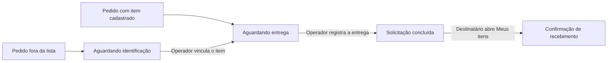

# Solicitações e trocas

## Fazer um pedido

1. Abra **Solicitações → Meus pedidos → Solicitar item**. No perfil Colaborador, **Solicitações** abre a área pessoal diretamente.
2. Busque e selecione um item ativo, informe a quantidade e o motivo e envie. Cada solicitação trata de um item.
3. Se o item estiver fora da lista, use **Não encontrei o item**, descreva o que precisa e envie. Um operador autorizado abre o pedido e usa **Vincular ao catálogo**. Pode cadastrar o item primeiro, se necessário.
4. Na configuração atual, o pedido identificado vai para a fila **Aguardando entrega** sem passar pelo encarregado. Nessa fila, os operadores veem a disponibilidade na unidade e a quantidade que falta.

## Situações do pedido

| Situação | O que acontece |
| --- | --- |
| **Aguardando identificação do item** | Um operador precisa vincular o pedido a um item ativo do cadastro. |
| **Pendente de aprovação** | Usada somente com o fluxo de aprovação ativado. O encarregado decide os pedidos da sua equipe. |
| **Aguardando entrega** | O pedido está na fila para a operação verificar e atender quando houver saldo elegível. |
| **Concluída** | O operador registrou a entrega. A confirmação do destinatário é acompanhada separadamente. |
| **Rejeitada** | Se a aprovação estiver ativa, o encarregado pode rejeitar e informar a justificativa. |
| **Cancelada** | O próprio solicitante ou o administrador cancelou o pedido ainda em aberto. |

## Troca e retirada de uso

- Em **Meus itens**, abra o item e use **Solicitar troca**. Para entregas que aguardam confirmação, a ação aparece em **Problemas com este item**, quando disponível.
- Informe a quantidade. A justificativa pode ser texto, foto ou ambos. O campo aceita JPG, PNG ou WebP de até **3 MB** e mostra a prévia antes do envio.
- Depois de enviar, abra **Solicitações → Ver detalhes** para visualizar a foto. O solicitante e os operadores com acesso ao pedido podem abrir a imagem em tamanho original.
- Use **Mais opções → Retirar de uso** para registrar vencimento, dano/desgaste ou outro motivo. A retirada exige justificativa escrita. O item sai da lista de uso, a entrega continua no histórico e o saldo conserva a baixa original.

O pedido de troca referencia a entrega de origem. O sistema restringe a ação à entrega elegível mais recente e admite um pedido de troca em aberto por entrega. Se o item original estiver inativo, a solicitação de troca entra como item a identificar. A nova entrega percorre o fluxo de baixa e recebimento.

## Aprovação guardada para uso futuro

O administrador pode guardar regras por unidade e item em **Regras de aprovação**. Com o fluxo desativado, essas regras ficam sem efeito sobre a fila.

O campo `Company.requestApprovalEnabled` controla o recurso por empresa e inicia como `false`. O formulário de regras guarda a configuração e a ativação é uma configuração técnica do sistema. Quando a aprovação estiver ativa, a regra do item tem prioridade sobre a regra geral da unidade. Na falta de ambas, a aprovação é exigida. Apenas o encarregado do escopo pode aprovar ou rejeitar.

A migração que desativou a aprovação encaminhou os pedidos pendentes com item cadastrado para **Aguardando entrega**. Os que ainda precisavam de identificação foram para **Aguardando identificação do item**.

[Voltar ao índice](README.md)
