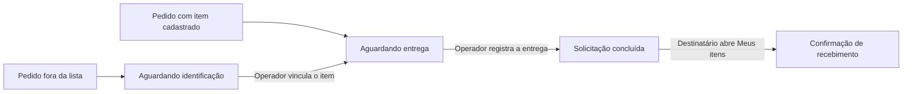

# Solicitações e trocas

## Fazer um pedido

1. Abra **Solicitações → Meus pedidos → Solicitar item**. No perfil Colaborador, **Solicitações** abre a área pessoal diretamente.
2. Busque e selecione um item ativo, informe a quantidade e o motivo e envie. Cada solicitação trata de um item.
3. Se o item estiver fora da lista, use **Não encontrei o item**, descreva o que precisa e envie. Um operador autorizado abre o pedido e usa **Vincular ao catálogo**. Pode cadastrar o item primeiro, se necessário.
4. Na configuração atual, o pedido identificado vai direto para **Aguardando entrega**. A fila operacional permite separar **Pronto para entregar**, **Falta estoque** e **Item a identificar**. Para saldo insuficiente, a tela mostra a quantidade em falta. Se o total estiver distribuído e nenhuma posição de estoque atender o pedido inteiro, a tela indica saldo dividido.

Em **Meus pedidos**, o colaborador acompanha o envio, a situação atual, a entrega e a confirmação do recebimento. Quando a entrega é registrada, **Ir para confirmação** leva ao registro em **Meus itens**. A disponibilidade nesse acompanhamento é calculada para a unidade atual do colaborador.

## Situações do pedido

| Situação | O que acontece |
| --- | --- |
| **Aguardando identificação do item** | Um operador precisa vincular o pedido a um item ativo do cadastro. |
| **Pendente de aprovação** | Usada somente com o fluxo de aprovação ativado. A Gerência decide os pedidos da sua equipe. |
| **Aguardando entrega** | O pedido está na fila para a operação verificar e atender quando houver saldo elegível. |
| **Concluída** | O operador registrou a entrega. A confirmação do destinatário é acompanhada separadamente. |
| **Rejeitada** | Se a aprovação estiver ativa, a Gerência pode rejeitar e informar a justificativa. |
| **Cancelada** | O próprio solicitante ou o administrador cancelou o pedido ainda em aberto. |

## Troca e retirada de uso

- Em **Meus itens**, abra o item e use **Solicitar troca**. Para entregas que aguardam confirmação, a ação aparece em **Problemas com este item**, quando disponível.
- Informe a quantidade. A justificativa pode ser texto, foto ou ambos. O campo aceita JPG, PNG ou WebP de até **3 MB** e mostra a prévia antes do envio.
- Depois de enviar, abra **Solicitações → Ver detalhes** para visualizar a foto. O solicitante e os operadores com acesso ao pedido podem abrir a imagem em tamanho original.
- Use **Mais opções → Retirar de uso** para registrar vencimento, dano/desgaste ou outro motivo. A retirada exige justificativa escrita. O item sai da lista de uso, a entrega continua no histórico e o saldo conserva a baixa original.

O pedido de troca referencia a entrega de origem. A troca fica disponível para a entrega elegível mais recente e para unidades restantes de uma entrega parcialmente devolvida. O sistema admite um pedido de troca em aberto por entrega. Se o item original estiver inativo, a solicitação de troca entra como item a identificar. A nova entrega percorre o fluxo de baixa e recebimento.

Em **Solicitações → Atender pedido**, preencha **Data da devolução** depois de receber o item antigo para descarte. O sistema registra a mesma quantidade atendida no pedido e mantém o saldo disponível sem entrada do item usado. A data fica visível no pedido e no Histórico da entrega original. Se a devolução for parcial, as demais unidades continuam com o colaborador.

As trocas concluídas antes deste fluxo preservam seus registros anteriores. Quando uma entrega de substituição é removida e o pedido volta à fila, a devolução já registrada fica disponível para o próximo atendimento.

## Aprovação guardada para uso futuro

O administrador pode guardar regras por unidade e item em **Regras de aprovação**. Com o fluxo desativado, essas regras ficam sem efeito sobre a fila.

O campo `Company.requestApprovalEnabled` controla o recurso por empresa e inicia como `false`. O formulário de regras guarda a configuração e a ativação é uma configuração técnica do sistema. Quando a aprovação estiver ativa, a regra do item tem prioridade sobre a regra geral da unidade. Na falta de ambas, a aprovação é exigida. Apenas a Gerência responsável pela equipe pode aprovar ou rejeitar.

A migração que desativou a aprovação encaminhou os pedidos pendentes com item cadastrado para **Aguardando entrega**. Os que ainda precisavam de identificação foram para **Aguardando identificação do item**.

[Voltar ao índice](README.md)
